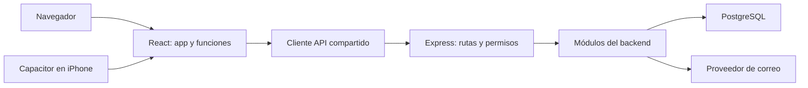

# Arquitectura de Antilia

Antilia usa un frontend organizado por funciones y un backend modular. Web y iPhone comparten las pantallas React y consumen la misma API HTTPS. PostgreSQL guarda los datos en el servidor.

## Frontend

| Carpeta | Responsabilidad |
|---|---|
| `frontend/src/main.tsx` | Inicia React, el contexto de sesión y el registro de instalación web |
| `frontend/src/app/` | Compone pantallas, navegación y estilos globales |
| `frontend/src/features/` | Agrupa pantallas, componentes y estado propios de una función |
| `frontend/src/shared/api/` | Cliente HTTP y tipos de respuesta compartidos |
| `frontend/src/shared/components/` | Botones, campos, navegación y estructura visual reutilizable |
| `frontend/src/shared/lib/` | Utilidades de fechas y validación |
| `frontend/public/` | Íconos, manifiesto y recursos de instalación |

Las funciones son `auth`, `account`, `home`, `tasks`, `spaces`, `desk`, `measurements`, `shifts`, `reminders`, `progress`, `focus`, `insights` e `installation`. Cada una contiene solo las carpetas que necesita, como `pages`, `components` o `context`.

La composición sigue `app → features → shared`. La sesión se expone desde `features/auth/context/AuthContext.tsx`. La sesión de orden reutiliza el tipo de tarea de `tasks`; si más funciones necesitan ese contrato, debe extraerse a un archivo de tipos de tareas. Los componentes compartidos no importan pantallas.

## Backend

| Carpeta o archivo | Responsabilidad |
|---|---|
| `backend/src/server.js` | Abre el puerto del servidor local |
| `backend/src/app.js` | Configura Express, recursos estáticos y manejo general de solicitudes |
| `backend/src/routes.js` | Registra los módulos bajo las rutas públicas existentes |
| `backend/src/modules/` | Rutas y servicios agrupados por función |
| `backend/src/shared/` | Validaciones y utilidades HTTP comunes |
| `backend/src/shared/middleware/` | Autenticación y respuesta uniforme de errores |
| `backend/src/infrastructure/database/` | Conexión y configuración de PostgreSQL |
| `backend/src/infrastructure/mail/` | Adaptador del proveedor de correo |
| `backend/migrations/` | Cambios de esquema ordenados y versionados |
| `backend/scripts/` | Operación, entorno local y comprobaciones |
| `backend/test/` | Pruebas de integración con base temporal local |

Los módulos son `auth`, `tasks`, `spaces`, `desk`, `measurements`, `shifts`, `stats`, `streak` y `reminders`. Verificación y recuperación pertenecen a `auth`; el despacho interno y la programación pertenecen a `reminders`.

Los archivos `*.routes.js` conservan los controladores y sus consultas SQL. Los recordatorios ya tienen servicios separados para programación y despacho. Cuando crezca otro módulo, su lógica reutilizada debe pasar a un servicio del mismo módulo; no se añaden capas vacías ni se duplican consultas. La conexión PostgreSQL permanece centralizada y las operaciones que deban ser atómicas usan transacciones.

## Publicación y distribución

- `api/index.js` adapta Express a Vercel.
- `vercel.json` mantiene los comandos de instalación, compilación y las rutas públicas.
- `frontend/capacitor.config.ts` configura el cliente iPhone.
- `.github/workflows/ios-ipa.yml` compila el IPA.
- `distribucion/ios/` contiene la distribución y su identificación de versión.
- `qa/` contiene recorridos de navegador; sus evidencias generadas no se publican.
- `docs/` contiene documentación, separada del código ejecutable.

La reorganización no cambia URLs de API, rutas de navegación, esquema de datos ni comandos de arranque. No requiere migraciones. El IPA existente corresponde al commit indicado en su guía; una compilación nueva usa la estructura actual.

## Cómo agregar una función

1. Ubica la pantalla y sus componentes en la función correspondiente del frontend.
2. Usa el cliente API compartido y evita solicitudes duplicadas dentro de componentes visuales.
3. Agrega las rutas al módulo del backend y regístralas en `routes.js` si es un módulo nuevo.
4. Valida entradas, autentica solicitudes y limita consultas al propietario de los datos.
5. Si cambia el esquema, crea una migración nueva; no modifiques migraciones aplicadas.
6. Comprueba el recorrido y actualiza su guía. Guarda claves en variables de entorno.

Los comandos de compilación, pruebas y ejecución están en [ejecución y despliegue](ejecucion-y-despliegue.md).
